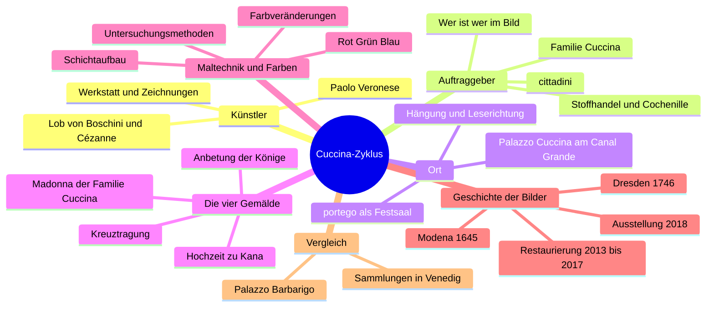

**06.10.26**

> **Hinweis:** Einstieg in die Wissenssammlung. Nutzung im Projekt: [[0. Projekt-Kompass]]. Begriffe: [[Glossar Cuccina-Zyklus]].

## 0.1 Die Geschichte in 60 Sekunden

Um 1571 malt Paolo Veronese vier riesige Leinwandbilder für die Cuccina, durch Stoffhandel reich gewordene venezianische *cittadini*. Die Bilder schmücken den *portego*, den Festsaal ihres Palastes am Canal Grande. Drei zeigen Szenen aus dem Leben Christi, auf dem vierten wird die Familie selbst der Madonna vorgestellt. Der Zyklus ist also **sakral und profan** zugleich. Die Bilder hingen erhöht und erzählten in der Laufrichtung der Gäste.

Heute hängen sie ohne ihren Raum in der **Gemäldegalerie Alte Meister Dresden**. Die Restaurierung zeigte, wie Veronese malte und dass vieles, was heute braun oder schwarz-weiß wirkt, einmal grün, violett oder blau war.

## 0.2 Steckbrief

| Merkmal | Angabe |
|---|---|
| **Werk** | vier großformatige Ölgemälde auf Leinwand |
| **Künstler** | Paolo Veronese (Familienname Caliari) mit Werkstatt, 1528–1588¹ |
| **Entstehung** | um 1571, auf dem Höhepunkt seines Schaffens |
| **Auftraggeber** | Familie Cuccina, Stoffhändler (*cittadini*) |
| **Ursprünglicher Ort** | *portego* im 1. Stock (*piano nobile*) des Palazzo Cuccina in Venedig, heute Palazzo Papadopoli |
| **Heute** | Gemäldegalerie Alte Meister, Staatliche Kunstsammlungen Dresden (SKD), Gal.-Nr. 224–227 |

## 0.3 Die vier Gemälde im Überblick

Es gibt zwei Formatgruppen (ca. 207 und ca. 165 cm hoch, alle über 4 m breit). Beide Größen sind original (→ [[4. Maltechnik, Farben und Restaurierung#4.3.2 Formate und Aufspannung|Formate]]). Genaue Maße und Beschreibungen: [[3. Die vier Gemälde]].

| Gal.-Nr. | Titel | Platz im portego² |
|---|---|---|
| 224 | Die Madonna der Familie Cuccina | Treppenseite, neben dem Aufgang |
| 225 | Die Anbetung der Könige | Gegenseite, gegenüber der Treppe |
| 226 | Die Hochzeit zu Kana | Gegenseite, zum Canal Grande |
| 227 | Die Kreuztragung | Treppenseite, zum Canal Grande |

² unsere Lesart der Rekonstruktion von S. Feil (1996/97, „unter Vorbehalt“) → [[2. Palazzo Cuccina und Portego#2.4 Die Rekonstruktion des Cuccina-Portego|Rekonstruktion]]

## 0.4 Zeitstrahl

| Zeit | Ereignis |
|---|---|
| Mitte 16. Jh. | Giangiacomo de' Grigi baut den Palazzo Cuccina |
| um 1571 | Veronese malt den Zyklus; im selben Jahr Seeschlacht von Lepanto gegen die Osmanen (Kontext aus Bergdolt) |
| erstes Drittel 17. Jh. | Kardinal Francesco Barberini und König Karl I. von England interessieren sich für die Bilder¹ |
| 1645 | Die Bilder gehen an Herzog Francesco I. d'Este von Modena¹ |
| 1674 | Marco Boschini lobt Veronese und beschreibt seine Arbeitsweise |
| 1746 | August III. (Kurfürst von Sachsen, König von Polen) kauft sie mit 96 weiteren Meisterwerken der Estensischen Sammlung für Dresden¹ |
| 18. und spätes 19. Jh. | Umbauten am Palazzo; der Saal ist heute nicht mehr original ausgestattet |
| 1996/97 | S. Feil rekonstruiert die Hängung im portego |
| 2013–2017 | Restaurierung mit naturwissenschaftlichen Untersuchungen¹ |
| 09.03.–03.06.2018 | Ausstellung mit Medienstationen und AR-Anwendungen der TU Dresden¹ |

Einträge ohne ¹ stammen aus den PDFs (Infoblatt, Giebe u. a., Bergdolt).

## 0.5 Themenkarte

Die Karte ist eine Vorstrukturierung der Quellen. Eure eigene Struktur entsteht im [[1. Informationen sammeln und strukturieren#1.3 Informationen strukturieren|Workbook]].

