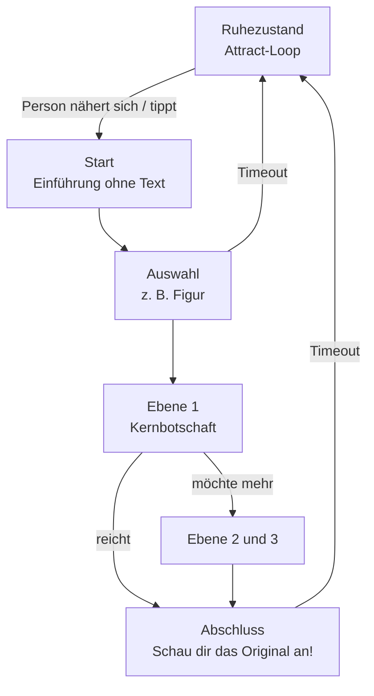

**06.10.26**

> **Hinweis:** Schritt 4 von 6 · zurück: [[3. Ideenfindung]] · weiter: [[5. Prototyp und Video]] · [[0. Projekt-Kompass]] · Grundlagen: [[Web- und Printdesign]] (MG), [[1. Wahrnehmung]], [[2. Licht und Farbmodelle]] (BILD)

## 4.1 Ziel dieses Schritts

Den Favoriten zum **Konzept** ausarbeiten, **2–3 Gestaltungsvarianten** entwickeln und eine davon begründet wählen.

**Bewertet (3 BE):** Idee ausführlich mit Bildern vorgestellt; Konzept trifft Thema und Zielgruppe. Im Vortrag ist das ein Schwerpunkt.

## 4.2 Idee oder Variante?

| | Ideen (Schritt 3) | Varianten (Schritt 4) |
|---|---|---|
| **Frage** | **Was** machen wir? | **Wie** genau? (dieselbe Idee, anders gestaltet) |
| **Beispiel** | „Farbzeitreise“ vs. „Wer ist wer?“ vs. „Zurück in den portego“ | Farbzeitreise als **A** Schieberegler am Medientisch, **B** Tablet-„Taschenlampe“ vor dem Original, **C** Projektion auf eine Kopie im Vorraum |

## 4.3 Das Konzept ausarbeiten

### 4.3.1 Konzeptsteckbrief

Claim (1 Satz) · Ziel (was wissen oder fühlen Besucher*innen danach?) · Persona · Kernbotschaften · Inhalte (Fakten, Bilder, Texte, Töne) · Interaktionsablauf · Ort und Aufbau · Technik · Gestaltung · Nutzungsdauer · Barrierefreiheit, Sprachen · Abgrenzung (z. B. zu den TU-Dresden-Medienstationen 2018)

### 4.3.2 Inhalte in Ebenen

Jede Ebene funktioniert für sich (Beispiele ausgedacht):

| Ebene | Dauer | Beispiel |
|---|---|---|
| **0 Anlocken** | Sekunden | Bild „atmet“, Farben wechseln zwischen 1571 und heute |
| **1 Kernbotschaft** | ca. 30 s | „So sah das Kleid 1571 aus – blau, nicht schwarz.“ |
| **2 Geschichte** | ca. 3 min | warum sich Smalte verändert, welche Stellen betroffen sind |
| **3 Vertiefung** | 10 min + | Querschliffe, Röntgenbilder, Pigmente |

### 4.3.3 Interaktionsablauf (User Flow)

- **Ruhezustand („Attract-Loop“):** zeigt, *dass* und *wie* man interagiert.
- **Timeout:** setzt zurück, wenn jemand weggeht.

Allgemeines Beispiel:

### 4.3.4 Raum und Aufstellung

Grundriss als Annahme skizzieren. Er zeigt die Bilder, die Installation mit **Sichtachse** zum Original, Wege ohne Blockade, die Bedienhöhe (auch im Sitzen bzw. vom Rollstuhl aus) sowie Strom und Ton.

## 4.4 Varianten entwickeln

### 4.4.1 Worin sich Varianten unterscheiden können

| Dimension | Beispiel |
|---|---|
| **Layout** | Vollbild mit Overlay vs. geteilter Bildschirm „damals / heute“ |
| **Interaktion** | Schieberegler vs. Taschenlampe vs. Geste |
| **Visueller Stil** | edel und zurückhaltend (Museum) vs. verspielt (Kinder) |
| **Sprache, Ton** | Erklärtext vs. Figuren erzählen selbst („Ich bin Zuanna …“) |
| **Physische Form** | Medientisch vs. Tablet am Ständer vs. Projektion |

Varianten **deutlich** unterscheiden (eine andere Schriftfarbe reicht nicht); je **ein Bild** (Scribble, Wireframe, Mockup) und **2–3 Sätze**, ähnlich detailliert.

### 4.4.2 Werkzeuge

Scribbles · Moodboard (Farben, Schriften, Bilder, Materialien; Collage, Figma, Miro, Canva) · Wireframes (Papier, Figma) · Storyboard ([[5. Prototyp und Video#5.6.3 Storyboard und Shotlist|Vorlage]]) · Papiermodell für Größe und Aufstellung

### 4.4.3 Gestaltung ableiten

- **Farbe:** Veroneses Zinnoberrot, Smalte- und Ultramarinblau, Grün, Gold, Komplementärkontraste ([[4. Maltechnik, Farben und Restaurierung#4.5 Farben|Farben]]). Auch der Farbwandel seit 1571 kann Thema sein.
- **Schrift:** gut lesbar, Titel eventuell mit Renaissance-Anmutung; **höchstens zwei Schriften**.
- **Kontrast:** mindestens **4,5:1** für Text (WCAG); Information nie nur über Farbe vermitteln.
- **Ordnung:** Gestaltgesetze wie Nähe, Ähnlichkeit, Geschlossenheit, Figur-Grund ([[1. Wahrnehmung]], Lernzettel MG); Farbwirkung siehe [[2. Licht und Farbmodelle]] (Usability – Farben).
- **Original im Mittelpunkt:** hinführen statt konkurrieren.

> **Merke:** Gestaltung ist der „bewusste und zielgerichtete Einsatz von visuellen, räumlichen und formalen Mitteln (kein Dekorationsmittel)“ ([[Web- und Printdesign]], MG). Sie muss also immer begründbar sein.

## 4.5 Varianten vergleichen und entscheiden

1. **Bewerten:** jede Variante (A, B, C) nach diesen Kriterien:
   - sofort verständlich?
   - passt zur Persona?
   - führt zum Original hin?
   - museumstauglich (Platz, Ruhe, Schutz der Originale)?
   - barrierefrei?
   - stimmig zum Thema?
   - umsetzbar?
2. **Feedback** von 3–5 Personen außerhalb des Teams: **5-Sekunden-Test** (Variante kurz zeigen: „Worum geht es? Was tust du als Erstes?“), dann „Welche würdest du nutzen, warum?“
3. **Entscheiden** und ins Logbuch: wichtigster Grund **und** bewusst akzeptierter Nachteil.

## 4.6 Fit-Check – passt das Konzept?

„Konzept trifft Thema und Zielgruppe“ ist ein eigenes Bewertungskriterium und bekommt einen eigenen Doku-Abschnitt. Beantwortet jede Frage mit Beleg:

1. **Thema:** Welche Kernbotschaft vermittelt das Konzept, und aus welcher Quelle stammt sie?
2. **Zielgruppe:** Welche Bedürfnisse und Frustrationen der Persona löst es?
3. **Ort:** Welche Anforderungen des Museums erfüllt es (Ruhe, Platz, Schutz der Originale, Barrierefreiheit)?
4. **Original:** Wie führt es zum Gemälde hin, statt es zu ersetzen?
5. **Abgrenzung:** Was ist neu gegenüber bestehenden Lösungen?

> **Formulierungshilfe:** „Unser Konzept richtet sich an [Persona], die laut unseren Interviews [Erkenntnis]. Es vermittelt [Kernbotschaft] (Quelle). Durch [Entscheidung] wird [Bedürfnis] erfüllt. Anders als [Referenz] …“

## 4.7 Checkliste

Was in die Doku gehört: [[6. Dokumentation und Präsentation#6.1.2 Gliederungsvorlage|Gliederung]]

- [ ] Steckbrief, Ebenen, User Flow, Raumskizze
- [ ] Moodboard, 2–3 Varianten mit Bild
- [ ] Vergleich, Feedback, Entscheidung
- [ ] Fit-Check
- [ ] Logbuch, Doku-Entwurf „Entwicklung einer Lösung“
