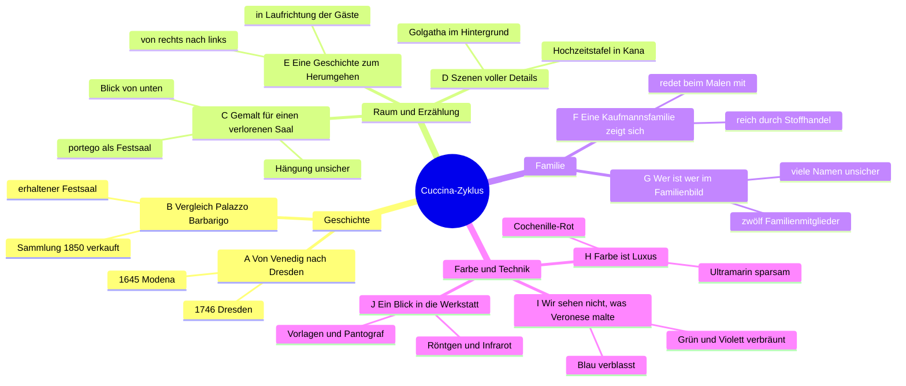

**20.10.26**

> **Hinweis:** Ergebnis von Schritt 1.3 nach der [[1. Informationen sammeln und strukturieren#1.3.3 Anleitung Affinity Diagram (60–90 Minuten)|Anleitung 1.3.3]] · Canvas: [[Affinity Diagram – vorher.canvas|vorher]] · [[Affinity Diagram – nachher.canvas|nachher]] · weiter: [[1. Informationen sammeln und strukturieren#1.3.5 Vom Wissen zur Geschichte – Kernbotschaften|Kernbotschaften]]

## Ablauf

KI-gestützt durchgeführt (Claude); in der Doku offen so beschreiben (→ [[6. Dokumentation und Präsentation#6.1.5 Quellen angeben|Hinweis zu KI]]).

| Schritt | Was passiert ist | Ergebnis |
|---|---|---|
| **1 Notieren** | 7 KI-Agents (Claude Sonnet), je einer pro Bereich der Wissenssammlung, schrieben einzeln Zettel: ein Fakt, höchstens 15 Wörter, mit Quelle und Fundstelle | 86 Zettel |
| **2 Aufhängen** | alle Zettel gemischt im Raster | [[Affinity Diagram – vorher.canvas\|vorher]] |
| **3 Stumm sortieren** | 3 weitere Agents sortierten unabhängig voneinander, jeder mit anders gemischter Liste und ohne Quellenangaben; Zettel, die die Mehrheit zusammenlegte, bilden eine Gruppe | 11 Gruppen, Übereinstimmung 83–100 % |
| **4 Benennen und verbinden** | 8 Dubletten zusammengelegt (ihre Fundstellen stehen am verbliebenen Zettel), die kleine Gruppe „Hängung“ in C aufgegangen, „Leben Christi“ von D nach E verschoben; Überschriften (lila) und 11 Beziehungen (Pfeile) | [[Affinity Diagram – nachher.canvas\|nachher]]: 10 Cluster, 78 Zettel |
| **5 Dot Voting** | **offen** (→ [[#Dot Voting – offen\|unten]]) | |
| **6 Foto „nachher“, Mindmap** | Screenshot nach dem Dot Voting; [[#Mindmap\|Mindmap]] aus den Clustern | |

## Erkenntnisse

- **Robuste Struktur:** Alle drei Sortierungen fanden dieselben zehn Themen.
- **Quer zur Wissenssammlung:** F, G und H mischen Zettel aus drei Bereichen (H: Farbhandel, Cochenille und Zuannas Kleid), C, D, E, I und J aus zwei. Nur A (Weg der Bilder) und B (Barbarigo) entsprechen je einem Kapitel.
- **Unsicheres steckt überall:** 12 Zettel sind nur vermutet, gedeutet oder „eigene Lesart“, verteilt auf 9 der 10 Cluster. Für das Konzept heißt das: Vermutungen und Rekonstruktionen durchgehend kennzeichnen (→ [[5. Prototyp und Video#5.4 Den Prototyp bauen|5.4]]).
- **Nebenspur:** B (Palazzo Barbarigo) liefert Vergleich und Bildvorlagen für den verlorenen Saal, keine eigene Geschichte zum Zyklus.

## Mindmap

Die vier Hauptäste sind die vier Spalten der Nachher-Canvas, darunter die Cluster.

## Dot Voting – offen

1. [[Affinity Diagram – nachher.canvas|Nachher-Canvas]] öffnen; oben rechts liegen 10 grüne und 10 rote Punkte.
2. 🟢 auf Zettel ziehen, die **spannend für Besucher*innen** sind, 🔴 auf **schwer verständliche**. Mehrere Punkte auf einem Zettel sind erlaubt; weitere Punkte per Kopieren (⌘C, ⌘V).
3. Screenshot „nachher“ als Abbildung für die Doku. Die Cluster mit den meisten 🟢 sind die Kandidaten für die [[1. Informationen sammeln und strukturieren#1.3.5 Vom Wissen zur Geschichte – Kernbotschaften|Kernbotschaften]].
