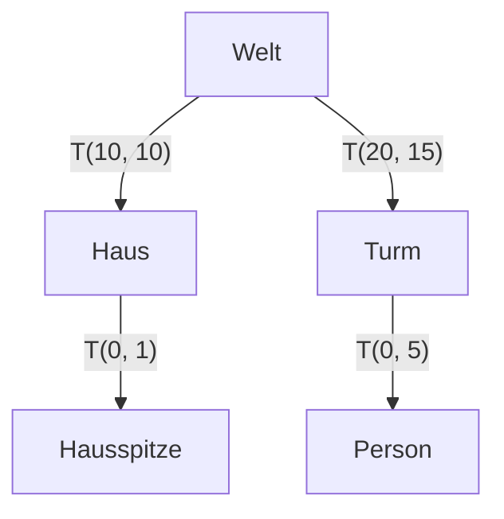
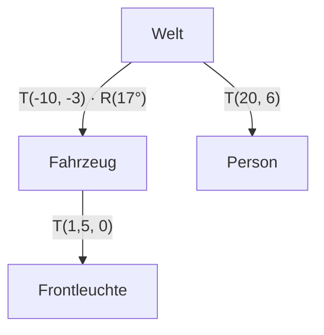

**28.10.26**

# Übung 1: Aufgabenblatt Transformationen

> [!info] Zugehöriger Vorlesungsstoff: [[3. 2D-Vektorgrafik#3.3 Geometrische Transformationen|3.3 Geometrische Transformationen]] und [[3. 2D-Vektorgrafik#3.4 Transformationshierarchien und Szenengraphen|3.4 Szenengraphen]]

## 1.1 Matrixmultiplikation

> [!todo]
> (1) Berechnen Sie $A \cdot B = C$ mit
> $$A = \begin{pmatrix} 4 & 5 & 3 \\ 10 & 1 & 6 \\ 2 & 2 & 7 \end{pmatrix}, \quad B = \begin{pmatrix} 5 & 3 & 9 \\ 5 & 6 & 8 \\ 4 & 1 & 9 \end{pmatrix}$$

Zeile von $A$ mal Spalte von $B$, z.B. $c_{11} = 4 \cdot 5 + 5 \cdot 5 + 3 \cdot 4 = 57$.

$$C = \begin{pmatrix} 57 & 45 & 103 \\ 79 & 42 & 152 \\ 48 & 25 & 97 \end{pmatrix}$$

## 1.2 Rotation

> [!todo]
> (2) Der Punkt $P$ hat die Koordinaten $(28, 7)$. Berechnen Sie $P'$ nach einer Rotation um $32°$ um den Ursprung.

Mit $\cos 32° \approx 0{,}8480$ und $\sin 32° \approx 0{,}5299$:

$$P' = \begin{pmatrix} \cos 32° & -\sin 32° \\ \sin 32° & \cos 32° \end{pmatrix} \begin{pmatrix} 28 \\ 7 \end{pmatrix} = \begin{pmatrix} 28 \cdot 0{,}8480 - 7 \cdot 0{,}5299 \\ 28 \cdot 0{,}5299 + 7 \cdot 0{,}8480 \end{pmatrix} \approx \begin{pmatrix} 20{,}04 \\ 20{,}77 \end{pmatrix}$$

## 1.3 Matrixinvertierung und Rücktransformation

> [!todo]
> (3) Reduziert man $M$ durch Zeilenoperationen zur Einheitsmatrix und wendet dieselben Operationen parallel auf $E$ an, entsteht aus $E$ die Inverse $M^{-1}$. Erlaubt sind: I. Zeilen vertauschen, II. Zeile mit reeller Zahl $\neq 0$ multiplizieren, III. Vielfaches einer Zeile zu einer anderen addieren/subtrahieren. Scheitert das Verfahren, ist $\det M = 0$ (Spaltenvektoren linear abhängig).
>
> a) Berechnen Sie die Inverse von $M = \begin{pmatrix} 2 & 1 \\ 1 & 1 \end{pmatrix}$ mittels Gaußscher Eliminierung.

$$\left(\begin{array}{cc|cc} 2 & 1 & 1 & 0 \\ 1 & 1 & 0 & 1 \end{array}\right)
\xrightarrow{\text{I: } Z_1 \leftrightarrow Z_2}
\left(\begin{array}{cc|cc} 1 & 1 & 0 & 1 \\ 2 & 1 & 1 & 0 \end{array}\right)
\xrightarrow{\text{III: } Z_2 - 2 Z_1}
\left(\begin{array}{cc|cc} 1 & 1 & 0 & 1 \\ 0 & -1 & 1 & -2 \end{array}\right)$$

$$\xrightarrow{\text{II: } Z_2 \cdot (-1)}
\left(\begin{array}{cc|cc} 1 & 1 & 0 & 1 \\ 0 & 1 & -1 & 2 \end{array}\right)
\xrightarrow{\text{III: } Z_1 - Z_2}
\left(\begin{array}{cc|cc} 1 & 0 & 1 & -1 \\ 0 & 1 & -1 & 2 \end{array}\right)$$

$$M^{-1} = \begin{pmatrix} 1 & -1 \\ -1 & 2 \end{pmatrix}$$

Probe: $M \cdot M^{-1} = \begin{pmatrix} 2-1 & -2+2 \\ 1-1 & -1+2 \end{pmatrix} = E$.

> [!todo]
> b) Welche Art von Transformation repräsentiert die Matrix?

Eine lineare Transformation (der Ursprung bleibt fest). Die Spalten $(2,1)^T$ und $(1,1)^T$ sind weder orthonormal (keine reine Rotation) noch achsenparallel (keine reine Skalierung). Die Matrix zerfällt in zwei Scherungen:

$$M = \begin{pmatrix} 1 & 1 \\ 0 & 1 \end{pmatrix} \cdot \begin{pmatrix} 1 & 0 \\ 1 & 1 \end{pmatrix}$$

Wegen $\det M = 2 \cdot 1 - 1 \cdot 1 = 1$ bleibt der Flächeninhalt erhalten.

> [!todo]
> c) Transformieren Sie $P = (3,4)$ mittels $M$ und den sich ergebenden Punkt mit $M^{-1}$ (Rücktransformation).

$$P' = M \cdot P = \begin{pmatrix} 2 \cdot 3 + 1 \cdot 4 \\ 1 \cdot 3 + 1 \cdot 4 \end{pmatrix} = \begin{pmatrix} 10 \\ 7 \end{pmatrix}$$

$$M^{-1} \cdot P' = \begin{pmatrix} 10 - 7 \\ -10 + 14 \end{pmatrix} = \begin{pmatrix} 3 \\ 4 \end{pmatrix} = P$$

> [!todo]
> (4) Wie sehen die Inversen der Standardtransformationen Rotation, Skalierung und Translation aus?

Die Inverse macht die Transformation rückgängig:

- **Rotation:** in die Gegenrichtung drehen. $R(\theta)^{-1} = R(-\theta) = R(\theta)^T$
- **Skalierung:** mit den Kehrwerten skalieren ($s_x, s_y \neq 0$). $S(s_x, s_y)^{-1} = S\left(\tfrac{1}{s_x}, \tfrac{1}{s_y}\right)$
- **Translation:** in die Gegenrichtung verschieben. $T(d_x, d_y)^{-1} = T(-d_x, -d_y)$

$$R(-\theta) = \begin{pmatrix} \cos\theta & \sin\theta & 0 \\ -\sin\theta & \cos\theta & 0 \\ 0 & 0 & 1 \end{pmatrix}, \quad S\left(\tfrac{1}{s_x}, \tfrac{1}{s_y}\right) = \begin{pmatrix} \tfrac{1}{s_x} & 0 & 0 \\ 0 & \tfrac{1}{s_y} & 0 \\ 0 & 0 & 1 \end{pmatrix}, \quad T(-d_x, -d_y) = \begin{pmatrix} 1 & 0 & -d_x \\ 0 & 1 & -d_y \\ 0 & 0 & 1 \end{pmatrix}$$

## 1.4 Window-Viewport-Transformation

> [!todo]
> (5) Leiten Sie die Matrix für die Gesamttransformation $G(u_{min}, v_{max}, s_x, -s_y, -x_{min}, -y_{min})$ her.

$G$ setzt sich aus drei Schritten zusammen (rechts steht der erste):

1. Fenster in den Ursprung verschieben: $T(-x_{min}, -y_{min})$
2. Auf Viewport-Größe skalieren und an der x-Achse spiegeln ($v$ zeigt nach unten): $S(s_x, -s_y)$
3. An die Viewport-Ecke verschieben: $T(u_{min}, v_{max})$

$$S(s_x, -s_y) \cdot T(-x_{min}, -y_{min}) = \begin{pmatrix} s_x & 0 & -s_x x_{min} \\ 0 & -s_y & s_y y_{min} \\ 0 & 0 & 1 \end{pmatrix}$$

$$G = T(u_{min}, v_{max}) \cdot S(s_x, -s_y) \cdot T(-x_{min}, -y_{min}) = \begin{pmatrix} s_x & 0 & u_{min} - s_x x_{min} \\ 0 & -s_y & v_{max} + s_y y_{min} \\ 0 & 0 & 1 \end{pmatrix}$$

mit $s_x = \dfrac{u_{max} - u_{min}}{x_{max} - x_{min}}$ und $s_y = \dfrac{v_{max} - v_{min}}{y_{max} - y_{min}}$. Das entspricht $u = u_{min} + s_x (x - x_{min})$ und $v = v_{max} - s_y (y - y_{min})$.

> [!todo]
> (6) Gegeben ist ein Fenster in Weltkoordinaten durch $P_1 (0{,}1 | 0{,}3)$, $P_2 (0{,}9 | 0{,}3)$, $P_3 (0{,}1 | 0{,}8)$, $P_4 (0{,}9 | 0{,}8)$ und ein Dreieck $A (0{,}4 | 0{,}4)$, $B (0{,}7 | 0{,}4)$, $C (0{,}7 | 0{,}7)$ darin. Der Viewport ist durch $Q_1 (1 | 2)$, $Q_2 (5 | 2)$, $Q_3 (1 | 10)$, $Q_4 (5 | 10)$ gegeben. Berechnen Sie das Dreieck in Viewportkoordinaten.

Fenster: $x_{min} = 0{,}1$, $x_{max} = 0{,}9$, $y_{min} = 0{,}3$, $y_{max} = 0{,}8$. Viewport: $u_{min} = 1$, $u_{max} = 5$, $v_{min} = 2$, $v_{max} = 10$.

$$s_x = \frac{5 - 1}{0{,}9 - 0{,}1} = 5, \quad s_y = \frac{10 - 2}{0{,}8 - 0{,}3} = 16$$

$$G = \begin{pmatrix} 5 & 0 & 1 - 5 \cdot 0{,}1 \\ 0 & -16 & 10 + 16 \cdot 0{,}3 \\ 0 & 0 & 1 \end{pmatrix} = \begin{pmatrix} 5 & 0 & 0{,}5 \\ 0 & -16 & 14{,}8 \\ 0 & 0 & 1 \end{pmatrix}$$

| Punkt | Rechnung | Viewport $(u \mid v)$ |
|---|---|---|
| $A (0{,}4 \mid 0{,}4)$ | $5 \cdot 0{,}4 + 0{,}5 \mid -16 \cdot 0{,}4 + 14{,}8$ | $(2{,}5 \mid 8{,}4)$ |
| $B (0{,}7 \mid 0{,}4)$ | $5 \cdot 0{,}7 + 0{,}5 \mid -16 \cdot 0{,}4 + 14{,}8$ | $(4 \mid 8{,}4)$ |
| $C (0{,}7 \mid 0{,}7)$ | $5 \cdot 0{,}7 + 0{,}5 \mid -16 \cdot 0{,}7 + 14{,}8$ | $(4 \mid 3{,}6)$ |

Probe: Die Fenster-Ecke $P_1 = (0{,}1 \mid 0{,}3)$ landet auf $Q_3 = (1 \mid 10)$, also unten links im Viewport (da $v$ nach unten wächst).

## 1.5 Rotation um einen beliebigen Punkt

> [!todo]
> (7) Leiten Sie die Gesamtmatrix für die Rotation um einen beliebigen Punkt $R(\alpha, x_0, y_0)$ her.

Der Drehpunkt wird in den Ursprung verschoben, dort gedreht und zurückgeschoben (rechts steht der erste Schritt):

$$R(\alpha, x_0, y_0) = T(x_0, y_0) \cdot R(\alpha) \cdot T(-x_0, -y_0)$$

$$R(\alpha) \cdot T(-x_0, -y_0) = \begin{pmatrix} \cos\alpha & -\sin\alpha & -x_0 \cos\alpha + y_0 \sin\alpha \\ \sin\alpha & \cos\alpha & -x_0 \sin\alpha - y_0 \cos\alpha \\ 0 & 0 & 1 \end{pmatrix}$$

$$R(\alpha, x_0, y_0) = \begin{pmatrix} \cos\alpha & -\sin\alpha & x_0 (1 - \cos\alpha) + y_0 \sin\alpha \\ \sin\alpha & \cos\alpha & y_0 (1 - \cos\alpha) - x_0 \sin\alpha \\ 0 & 0 & 1 \end{pmatrix}$$

Der Drehpunkt bleibt fest: $R(\alpha, x_0, y_0) \cdot (x_0, y_0, 1)^T = (x_0, y_0, 1)^T$.

## 1.6 Szenengraphen

> [!todo]
> (8) In einer 2D-Welt steht bei $(10, 10)$ (Weltkoordinaten) ein Haus mit der Hausspitze bei $(0, 1)$ (Hauskoordinaten). Bei $(20, 15)$ steht ein Turm, darauf eine Person bei $(0, 5)$ (Turmkoordinaten).
>
> a) Skizzieren Sie den Szenengraph.

> [!todo]
> b) Welchen Abstand hat die Person von der Hausspitze?

Beide Punkte in Weltkoordinaten (Pfad von der Wurzel, 1. Transformation steht rechts):

- Hausspitze: $T(10,10) \cdot T(0,1)$ ergibt $(10, 11)$
- Person: $T(20,15) \cdot T(0,5)$ ergibt $(20, 20)$

$$d = \sqrt{(20-10)^2 + (20-11)^2} = \sqrt{100 + 81} = \sqrt{181} \approx 13{,}45$$

> [!todo]
> (9) Eine Person steht auf einem Berg und beobachtet ein sich näherndes Fahrzeug. Das Fahrzeug steht bei $(-10, -3)$ (global) und ist um $17°$ gegen den Uhrzeigersinn rotiert. Die Frontleuchte liegt bei $(1{,}5, 0)$ in lokalen Fahrzeugkoordinaten. Die Person steht bei $(20, 6)$ (global).
>
> ![[1-fahrzeug-berg.jpeg]]
>
> a) Skizzieren Sie den Szenengraph.

> [!todo]
> b) Berechnen Sie die Position der Frontleuchte in lokalen Koordinaten der Person.

Die Leuchte in Weltkoordinaten ($\cos 17° \approx 0{,}9563$, $\sin 17° \approx 0{,}2924$):

$$L_W = T(-10,-3) \cdot R(17°) \cdot T(1{,}5, 0) \cdot \begin{pmatrix} 0 \\ 0 \\ 1 \end{pmatrix} = \begin{pmatrix} -10 + 1{,}5 \cos 17° \\ -3 + 1{,}5 \sin 17° \\ 1 \end{pmatrix} \approx \begin{pmatrix} -8{,}57 \\ -2{,}56 \\ 1 \end{pmatrix}$$

Zurück in die Personenkoordinaten mit der Inversen der Personen-Transformation, $T(20,6)^{-1} = T(-20,-6)$ (analog zu $T_{PA} = T_{Prop}^{-1}$ im Szenengraph-Beispiel der Vorlesung):

$$L_P = T(-20,-6) \cdot L_W \approx \begin{pmatrix} -28{,}57 \\ -8{,}56 \\ 1 \end{pmatrix}$$

Gesamtmatrix: $T(-20,-6) \cdot T(-10,-3) \cdot R(17°) \cdot T(1{,}5, 0)$. Das Koordinatensystem der Person ist nicht rotiert, daher bleibt es bei einer reinen Verschiebung.
