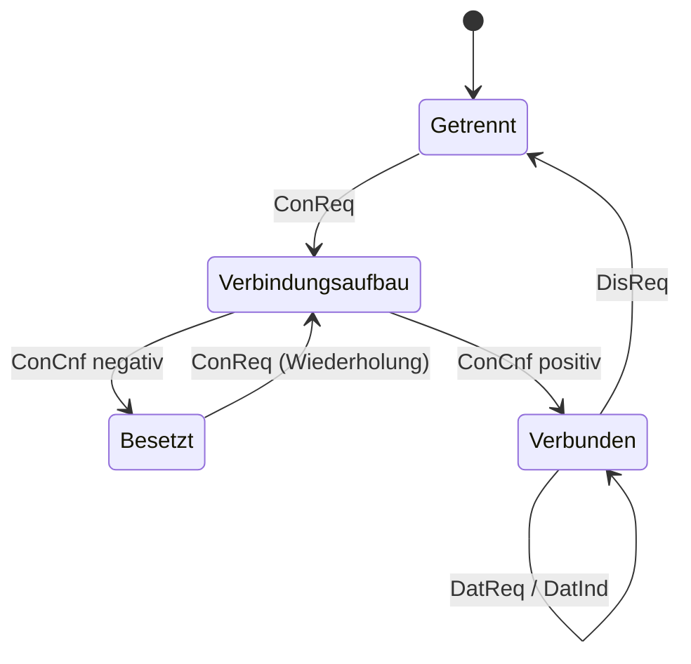

**06.10.25**

# Übung 1: Einführung

> [!info] Zugehöriger Vorlesungsstoff: [[1. Motivation]], [[2. Grundkonzepte]]

Aufgabenstellungen zur Übung 1 (Modul BERN-30, Rechnernetze, Prof. Dr. habil. Luntovskyy). Lösungen sind im Übungsblatt nicht enthalten.

## 1.1 Rechnernetzstrukturen

> [!todo]
> (1) Wie viele Verbindungsleitungen benötigen Sie bei Sterntopologie, um 5 Rechner zu verbinden?

$5$ Leitungen. Jeder Rechner hat eine eigene Leitung zum zentralen Knoten (der Zentralknoten zählt nicht als Rechner). Liegt der Zentralknoten auf einem der 5 Rechner, sind es nur $4$.

> [!todo]
> (2) Wie viele Verbindungsleitungen benötigen Sie in einem Netz mit 5 Rechnern bei vollvermaschter Topologie (jeder Rechner ist mit jedem anderen Rechner über eine Leitung verbunden)?

$\binom{5}{2} = \mathbf{10}$ Leitungen.

> [!todo]
> (3) Wie erhöht sich die Leitungszahl in den Fällen a) und b), wenn ein zusätzlicher Rechner in das Netz eingebunden wird?

- **Sterntopologie:** $+1$ Leitung ($5 \to 6$).
- **Vollvermaschung:** $+5$ Leitungen, denn der neue Rechner braucht je eine Leitung zu jedem der 5 bisherigen: $15$.

Allgemein wächst die Stern-Leitungszahl linear um $1$, die vollvermaschte Zahl um $n$ (bei $n$ bisherigen Rechnern).

## 1.2 Netzwerkarchitektur

> [!todo]
> (1) Grenzen Sie die Begriffe Dienst und Protokoll gegeneinander ab!

- **Dienst** beschreibt, *was* eine Schicht der darüberliegenden Schicht anbietet. Er besteht aus Dienstelementen (z. B. Request, Indication, Response, Confirm), die an der Schnittstelle zwischen zwei benachbarten Schichten (SAP) genutzt werden. Die Implementierung bleibt dabei verborgen.
- **Protokoll** legt fest, *wie* gleichrangige Instanzen (Peer-Entitäten) auf derselben Schicht miteinander kommunizieren: Nachrichtenformat, Reihenfolge und Reaktionen. Der Austausch läuft über Protokoll-Dateneinheiten (PDU).

Der Dienst wirkt also **vertikal** an der Schichtgrenze, das Protokoll **horizontal** zwischen den Partnern.

> [!todo]
> (2) Welche der OSI-Schichten beschäftigt sich jeweils mit
> - Aufteilung des Bitstroms in Rahmen
> - Ende-zu-Ende-Kommunikation
> - Wegewahl?

- **Aufteilung des Bitstroms in Rahmen:** Sicherungsschicht (Schicht 2)
- **Ende-zu-Ende-Kommunikation:** Transportschicht (Schicht 4)
- **Wegewahl:** Vermittlungsschicht (Schicht 3)

> [!todo]
> (3) Warum benötigen Vermittlungsstellen weniger Schichten?

Vermittlungsstellen (Router, Switches) leiten Informationen nur weiter. Sie müssen dafür die Schichten 1 bis 3 (Router) bzw. 1 bis 2 (Switch) kennen. Die Funktionen der Schichten 4 bis 7 betreffen nur die Endsysteme und werden auf Vermittlungsstellen nicht benötigt.

## 1.3 OSI-Schichtenarchitektur

> [!todo]
> (1) Wie hängen Interface Data Unit, Service Data Unit und Protocol Data Unit zusammen?

- **SDU:** Die Nutzdaten, die eine Schicht von oben bekommt.
- **PDU:** Die SDU mit dem Header der Schicht. Sie wird über das Netz geschickt.
- **IDU:** Das, was an der Schnittstelle zwischen zwei Schichten übergeben wird. Das ist die SDU zusammen mit Steuerinformationen für die Schnittstelle.

Die PDU einer Schicht wird zur SDU der Schicht darunter. Beim Senden kommt also in jeder Schicht ein neuer Header dazu.

> [!todo]
> (2) Ein Rechnernetz mit einer 7-Schichtenarchitektur habe pro Schicht einen Verlust der Übertragungsrate von 10 % infolge Overheads. Wie hoch ist die Anwendungs-Übertragungsrate in einem Fast-Ethernet-LAN (100 Mbit/s)?

Jede der 7 Schichten behält 90 % der Rate, die Verluste wirken also nacheinander (multiplikativ):

$$R_{\text{App}} = 100 \text{ Mbit/s} \cdot 0{,}9^7 = 100 \text{ Mbit/s} \cdot 0{,}4783 \approx \mathbf{47{,}8 \text{ Mbit/s}}$$

Die Anwendung erreicht also etwa 47,8 Mbit/s.

## 1.4 Dienstelemente

> [!todo]
> (1) Verändern/Erweitern Sie das Ablaufdiagramm (s. Folie im VL-Skript) in der Weise, dass Prozess A bei einer ersten Verbindungsaufnahme ein Besetztzeichen hört und damit keine Verbindung zustande kommt. Erst beim zweiten Versuch soll die Verbindung zwischen Prozess A und Prozess B aufgebaut werden.

Der erste Verbindungsversuch scheitert, weil B belegt ist. Die Vermittlung meldet das negativ zurück (ConCnf negativ), und A hört das Besetztzeichen. Erst der zweite Versuch läuft wie der Normalablauf aus 2.7.

![[ue1-ablaufdiagramm-besetzt.svg]]

> [!todo]
> (2) Erstellen Sie ein dazugehöriges Zustandsdiagramm (s. Folie im VL-Skript) entsprechend den Vorgaben von Aufgabe 1!

Das Zustandsdiagramm zeigt die Zustände von Prozess A. Der Besetzt-Zustand ist neu, er erklärt den gescheiterten ersten Versuch.

> [!todo]
> (3) Vergleichen Sie beide Protokolldarstellungsformen bezüglich
> - Übersichtlichkeit beim Normalablauf,
> - Anzahl der Diagramme bei alternativen Abläufen,
> - Vorlage für Programmierung und Implementierung!

- **Übersichtlichkeit beim Normalablauf:** Das Ablaufdiagramm ist hier klar im Vorteil. Die Nachrichten stehen in zeitlicher Reihenfolge untereinander, sodass man sofort sieht, wer wann was sendet. Beim Zustandsdiagramm muss man die Abfolge aus den einzelnen Übergängen zusammensetzen.
- **Anzahl der Diagramme bei alternativen Abläufen:** Jeder Ablauf braucht beim Ablaufdiagramm ein eigenes Diagramm, hier also zwei (Besetzt-Fall und Erfolgsfall). Das Zustandsdiagramm deckt alle Abläufe in einem Diagramm ab, Alternativen sind nur zusätzliche Zustände und Übergänge.
- **Vorlage für Programmierung und Implementierung:** Das Zustandsdiagramm lässt sich direkt umsetzen, etwa als Zustandsvariable mit einer `switch`-Anweisung, in der jeder Zustand auf die Ereignisse reagiert. Das Ablaufdiagramm beschreibt nur einzelne Szenarien und eignet sich eher als Vorlage für Tests und Spezifikation.
