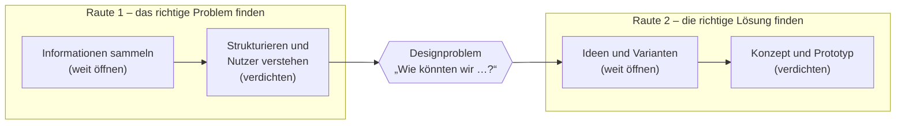

**06.10.26**

> **Hinweis:** **Hier anfangen.** Danach Schritt für Schritt: [[1. Informationen sammeln und strukturieren]] → [[2. Nutzer spezifizieren]] → [[3. Ideenfindung]] → [[4. Konzeption und Varianten]] → [[5. Prototyp und Video]] → [[6. Dokumentation und Präsentation]]. Fachwissen: [[0. Der Cuccina-Zyklus auf einen Blick]]. Checklisten stehen am Ende jeder Workbook-Notiz.

## 0.1 Worum es geht

**Aufgabe:** Ihr entwerft ein **Konzept für eine interaktive Museumsinstallation** zum Cuccina-Zyklus und zeigt dabei, dass ihr einen Designprozess sauber durchlaufen und dokumentieren könnt. Gebaut wird nichts: Skizzen, ein einfacher Prototyp und ein kurzes Video zeigen, wie es funktionieren würde.

**Thema:** Vier riesige Bilder von Paolo Veronese (um 1571), gemalt für den Festsaal (*portego*) einer venezianischen Stoffhändlerfamilie, hängen heute ohne diesen Zusammenhang in der Gemäldegalerie Alte Meister Dresden. Ihre verborgenen Geschichten (Raum, Familie, Korrekturen, veränderte Farben) sieht man nicht; eure Installation macht etwas davon **erlebbar** (→ [[1. Informationen sammeln und strukturieren#1.3.5 Vom Wissen zur Geschichte – Kernbotschaften|„Aha“-Fakten]]).

**Was zählt:** Fast jedes Kriterium fragt nach **Methode, Bild oder Begründung**, bewertet wird also vor allem der **Weg**. Eine einfache, sauber abgeleitete Idee schlägt eine spektakuläre ohne Begründung, und was nicht dokumentiert ist (Foto und ein paar Sätze pro Session), zählt nicht.

## 0.2 Warum all diese Schritte?

### 0.2.1 Der Designprozess als Doppel-Raute

Die Aufgabenstellung führt von der **Analyse des Sachverhaltes** über die **Definition des Designproblems** und die **Entwicklung von Designvarianten** zum **konzeptionellen Prototyp**. Das ist der **Double Diamond**: zweimal erst öffnen, dann verdichten.



**Öffnen** heißt viel sammeln und nichts bewerten, **verdichten** heißt auswählen und begründet entscheiden. Ohne Raute 1 löst man das falsche Problem („wir machen eine App“, aber was soll drinstehen und für wen?), ohne Öffnen in Raute 2 nimmt man die erstbeste Idee.

> **Hinweis:** Verwendet die Vorlesung ein anderes Modell (z. B. Design Thinking oder den menschzentrierten Gestaltungsprozess nach DIN EN ISO 9241-210), nehmt dessen Begriffe; die Logik bleibt gleich.

### 0.2.2 Der rote Faden – ein Beispiel

*Ausgedachtes Beispiel, wie jeder Schritt auf dem vorigen aufbaut (eure Kette entsteht aus euren Ergebnissen):*

1. **Sammeln, Strukturieren:** Die Kinderkleider waren ursprünglich blau → Cluster „Farben haben sich verändert“ → Kernbotschaft „Wir sehen die Bilder nicht so, wie Veronese sie malte.“
2. **Nutzer:** Eltern erzählen, dass sie vor großen Bildern nur kurz bleiben und Kinder „Was ist das?“ fragen → Persona „Familie mit Grundschulkind“.
3. **Designproblem:** „Wie könnten wir Familien in unter drei Minuten zeigen, wie die Bilder 1571 aussahen?“
4. **Ideen, Varianten:** Farb-Taschenlampe, Vorher-Nachher-Schieberegler, Malschichten-Puzzle → die Taschenlampe als Tablet-App oder als Projektion auf eine Bildkopie.
5. **Prototyp:** Figma-Klickdummy, mit vier Personen getestet; das Video zeigt eine Familie vor dem Bild.

## 0.3 Abgaben

| | Dokumentation | Präsentation |
|---|---|---|
| **Wer** | **jede*r einzeln** („von jedem selbst anzufertigen“) | Gruppe, gleichwertige Sprechanteile |
| **Was** | alle Arbeitsschritte und Ergebnisse | Folien zu den Teilergebnissen, Prototyp als **kurzes Video** |
| **Wann, wo** | bis **08.12.** in **OPAL** | **09.12.** im Kurs |
| **Fokus, Umfang** | alle Schritte; Umfang nicht angegeben (erfragen) | Ideenfindung, Varianten der Gestaltlösung, Prototyp; Dauer „wird noch bekannt gegeben“ |

**Pflichtinhalte der Doku:** Einleitung mit Motivation · Analyse (**Sammeln**, **Strukturieren**, mit Bildern) · zwei Methoden der **Nutzeranalyse** · **Ideenfindung** mit Favoriten · **Lösung** mit Varianten · **Prototyp** mit Vor- und Nachteilen · **Fazit** mit Ausblick → [[6. Dokumentation und Präsentation#6.1.2 Gliederungsvorlage|Gliederungsvorlage]].

> **Hinweis:** „Fangt bereits zeitig mit dem Dokument an und nehmt alle Arbeitsschritte darin auf.“ (Aufgabenstellung) → [[#0.6.4 Das Prozess-Logbuch|Logbuch]]. **Termine prüfen:** Das PDF nennt „9.12.25“ und stammt wohl aus dem letzten Durchgang. Geplant wird mit **Di 08.12.2026** (Abgabe) und **Mi 09.12.2026** (Präsentation); bitte bei der Lehrperson bestätigen lassen.

## 0.4 Bewertung (24 BE)

| Bereich (BE) | Kriterien laut Aufgabenstellung | So holt ihr die Punkte |
|---|---|---|
| **Analyse (6)** | Sammeln: Methode, Inhaltsthemen · Strukturieren: Methode, Bild · Nutzer spezifizieren: Methoden, Bilder | Methoden erklären; Themenliste mit Quellen; Struktur als Bild; je Nutzer-Methode ein Bild |
| **Ideenfindung (4)** | UX-Methode · mindestens 3 Ideen als Text und Bild | Methode mit Ablauf und Sessionfoto; Ideen mit Skizze |
| **Verfeinerung der Idee – Konzeption (3)** | favorisierte Idee ausführlicher, mit Bildern · Konzept trifft Thema und Zielgruppe | Ablauf, Raumskizze, Varianten; Passung **ausdrücklich** begründen |
| **Prototyp (5)** | UX-Methode · kurze Bewertung mit Vor- und Nachteilen | Methode begründen; Vor- und Nachteile aus einem Kurztest |
| **Video (2)** | Video transportiert das Konzept | 1–2 Minuten: wer, wo, was passiert, warum es hilft |
| **Formale Kriterien Doku (2)** | klares, einheitliches Layout; Bilder integriert, mit Bildunterschrift | Vorlage; Abbildungen nummeriert, beschriftet, mit Quelle |
| **Formale Kriterien Vortrag (2)** | klare Struktur, einheitliches Layout, Bilder integriert; gleichwertige Sprechanteile | Folienmaster, Sprechplan, Probedurchlauf |

- **Analyse und Prototyp** bringen 11 von 24 BE, dafür genug Zeit einplanen.
- **Formales (4 BE)** sind die leichtesten Punkte.
- **„Konzept trifft Thema und Zielgruppe“** bekommt einen eigenen Absatz (→ [[4. Konzeption und Varianten#4.6 Fit-Check – passt das Konzept?|Fit-Check]]).

## 0.5 Zeitplan

In Übungen mit Zwischenpräsentation zeigt ihr das Ergebnis der Woche.

| KW | Schritt | Leitfrage | Was ihr tut | Fertig, wenn … |
|---|---|---|---|---|
| 41 (06.–11.10.) | Start | — | Kompass und [[0. Der Cuccina-Zyklus auf einen Blick\|Wissenssammlung]] lesen; Rollen, Ablage, Logbuch, Doku-Vorlage; Termine klären | Ablage und Vorlage stehen |
| 42 (12.–18.10.) | [[1. Informationen sammeln und strukturieren\|1 Sammeln]] | Was gibt es zu erzählen? | Desk Research, Referenzanalyse (≥ 3 Beispiele) | Themenliste, Referenz-Steckbriefe |
| 43 (19.–25.10.) | [[1. Informationen sammeln und strukturieren\|1 Strukturieren]] | Was ist die Geschichte? | Affinity Diagram, Mindmap | Bild der Struktur, 3–5 Kernbotschaften |
| 44 (26.10.–01.11.) | [[2. Nutzer spezifizieren\|2 Nutzer]] | Für wen? Was genau lösen wir? | Kurzinterviews, Personas, Journey; Point of View, Anforderungen | Personas, Designproblem |
| 45 (02.–08.11.) | [[3. Ideenfindung\|3 Ideen]] | Wie könnte man es lösen? | Ideensession, Steckbriefe, Bewertung | ≥ 3 Ideen mit Skizze, Favorit |
| 46 (09.–15.11.) | [[4. Konzeption und Varianten\|4 Konzeption]] | Wie sieht die beste Idee genau aus? | Konzeptsteckbrief, User Flow, Raumskizze; 2–3 Varianten vergleichen | Konzept, Entscheidung |
| 47 (16.–22.11.) | [[5. Prototyp und Video\|5 Prototyp]] | Funktioniert es? | Prototyp bauen, Kurztest mit 3–5 Personen | Prototyp, Testnotizen |
| 48 (23.–29.11.) | [[5. Prototyp und Video\|5 Video]] | Kommt das Konzept rüber? | Storyboard, Dreh, Schnitt; Vor- und Nachteile | Video (Version 1) |
| 49 (30.11.–06.12.) | [[6. Dokumentation und Präsentation\|6 Finalisieren]] | Wie zeigen wir den Weg? | Doku fertig, Folien, Probevortrag mit Zeitmessung | alles final |
| 50 (07.–09.12.) | Abgabe | — | Di 08.12. Upload in OPAL, Mi 09.12. Präsentation | erledigt |

**Regeln:** wöchentlich ca. 30 Minuten dokumentieren · Skizzen dürfen bis in Raute 2 hässlich sein · Verzögerungen in den Folgephasen auffangen, nie in KW 49 · Feedback aus den Übungen ins Logbuch.

## 0.6 Zusammenarbeit im Team

### 0.6.1 Gemeinsam arbeiten, einzeln schreiben

- **Gemeinsam nutzen:** Fotos, Skizzen, Post-it-Wände, Personas, Prototyp, Video, Quellen, Gruppenentscheidungen.
- **Einzeln erstellen:** den Doku-Text (Methoden, Reflexion, Fazit) in eigenen Worten; gemeinsame Abbildungen als „eigene Darstellung (Gruppe …)“ kennzeichnen, im Zweifel nachfragen.

### 0.6.2 Rollen

Pro Phase wechselbar: Moderation (Zeit, Methode) · Dokumentation (Fotos, Logbuch, Ablage) · Recherche (Quellen mit Fundstelle) · Gestaltung (Skizzen, Prototyp) · Video.

### 0.6.3 Gemeinsame Ablage

Ein geteilter Ordner von `00_Organisation` (Zeitplan, Logbuch, Feedback) über je einen Ordner pro Phase bis `08_Abgabe` (Folien, Video, Bildquellen); Dateinamen mit Datum beginnen (`2026-10-21_affinity-diagram_01.jpg`).

### 0.6.4 Das Prozess-Logbuch

Nach jeder Session fünf Minuten ausfüllen, daraus schreibt sich die Doku fast von allein:

```markdown
## Sitzung TT.MM. – Thema
- Dabei:
- Methode:
- Was wir gemacht haben (2–3 Sätze):
- Ergebnis (Foto / Datei):
- Erkenntnis / Entscheidung (mit Begründung):
- Nächste Schritte (wer, bis wann):
```
